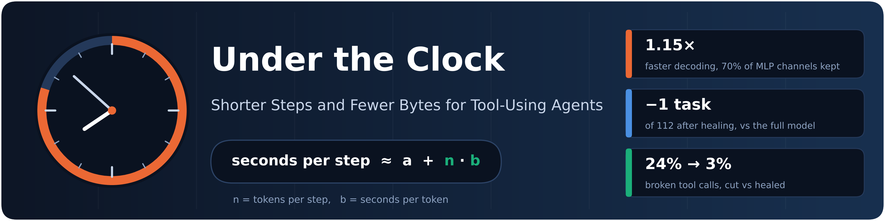
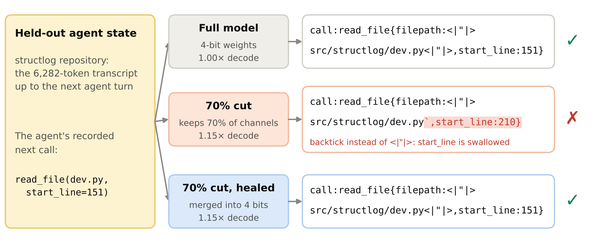
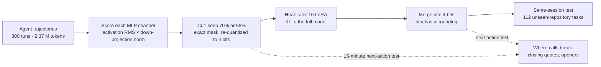
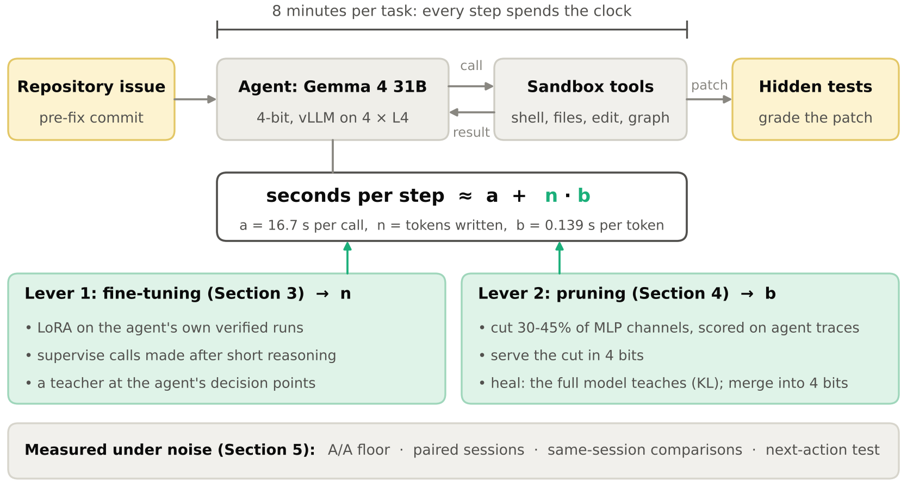
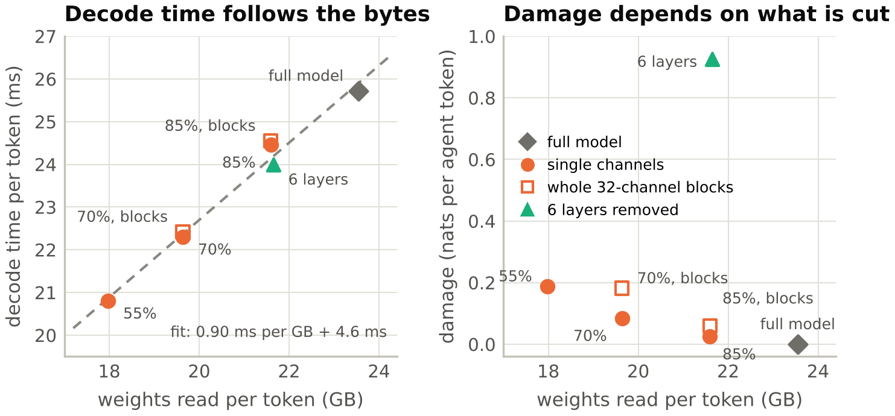
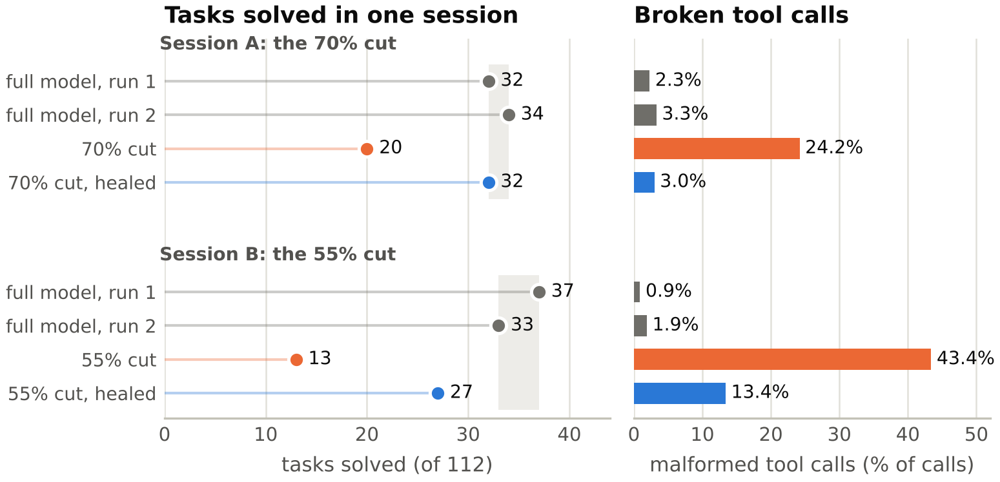
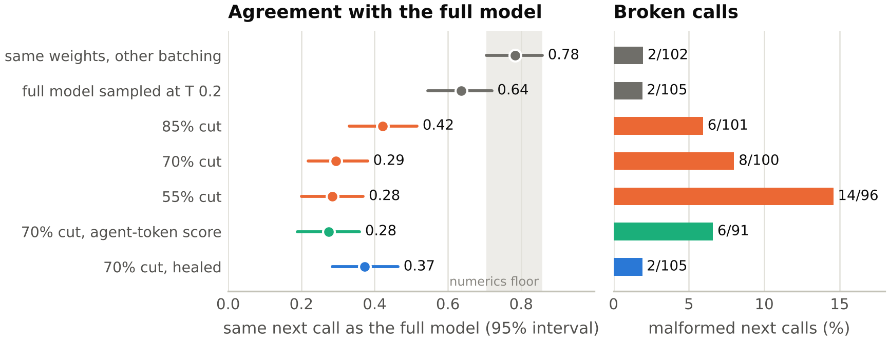
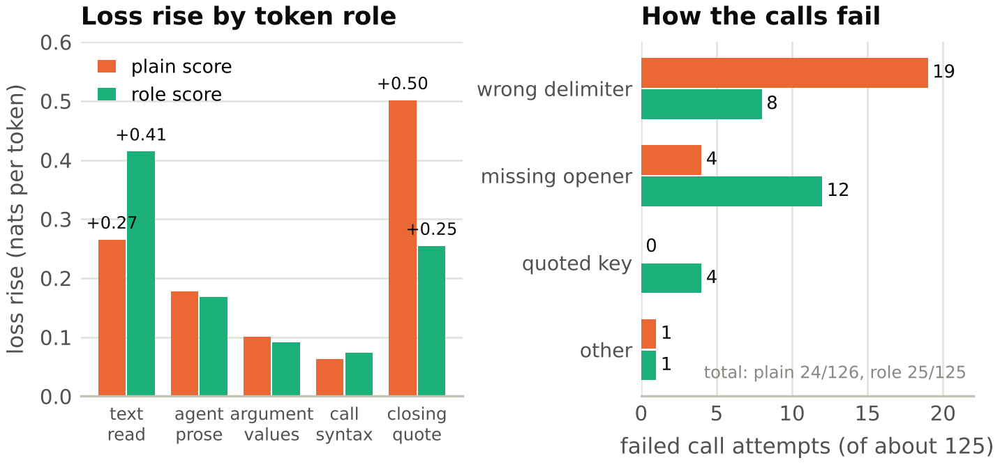
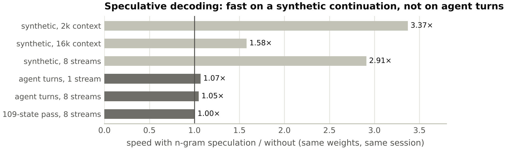

<p align="center">
  
</p>

<p align="center">
  <a href="docs/paper/arxiv/main.pdf"></a>
  
  <a href="https://www.kaggle.com/competitions/gemma-4-developer-agent"></a>
  <br>
  
  
  
  <a href="LICENSE"></a>
</p>

<p align="center">
  <b>Wilmer E. Henao</b> &nbsp;·&nbsp; Advanced Engineering, Invesco
</p>

---

An agent working under a clock gets more steps if each step is shorter (fewer tokens, *n*) or each token is faster
(fewer weight bytes read, *b*). We pulled both levers on **Gemma 4 31B**, served in 4 bits on four L4 GPUs with 8
minutes per repository issue, and traced every speed-up to **tasks solved**. This repository holds the paper, the code
behind it, the small result files behind every number, and the scripts that turn those files into the paper's
numbers and figures.

> [!NOTE]
> Every experiment ran as a Kaggle notebook. The [notebooks](#kaggle-notebooks) table below links each one; the
> [provenance](#where-each-number-comes-from) table maps each number in the paper to its notebook, result file and
> script.

## Highlights

- **Fine-tuning moves reasoning length before it moves actions.** Supervising only the tool calls made after short
  reasoning solved **25 vs 18** development tasks (8/1 discordant, p 0.039), though not on unseen repositories. A
  teacher's preferences halved the slow steps (**125 s → 56 s** at the 90th percentile) but broke the agent's stopping.
- **Pruning breaks tool-call syntax first.** Keeping 70% of the MLP channels, chosen on agent trajectories, decodes
  **1.15×** faster at +0.08 nats per agent token, yet the cut solved **20 of 112** tasks against 32 and 34 for two
  full-model runs (p 1.5e-5): its string arguments ran into one another in **24%** of its calls.
- **Healing from the full model fixes it.** A LoRA trained with KL to the full model and merged into the 4-bit weights by
  stochastic rounding keeps the speed and solves **32 of 112**, within noise of the full model (**−1 task**, 95%
  interval −7.5 to +5).
- **Average loss ranks cuts but cannot find the failure.** A 15-minute next-action test locates it, and shows a
  role-aware channel score moving the failure instead of removing it.

<p align="center">
  
  <br>
  <sub><b>Figure 1.</b> One held-out agent state, three models. The 70% cut ends the path with a backtick instead of
  Gemma's string delimiter <code>&lt;|"|&gt;</code> and swallows <code>start_line</code>. Healed and merged, it writes
  the full model's call.</sub>
</p>

## Results at a glance

| | intervention | speed | tasks under the 8-minute clock |
|:---:|---|---|---|
| 🧠 | **Short-thought** fine-tuning: supervise calls made after ≤ 1,500 characters of reasoning | 90th-percentile step text **0.90×** | **25 vs 18** on development repositories; a tie on unseen ones |
| 🎓 | **Teacher-DPO-2**: a stronger model's preferences at the agent's decision points | 90th-percentile step **56 s vs 125 s** | losses removed (20 vs 17), but the agent no longer stops |
| ✂️ | **70% cut**: 30% of MLP channels pruned, scored on agent trajectories | **1.15×** decode | **20 vs 32 / 34** of 112 (p 1.5e-5); 24% malformed calls |
| 🩹 | **70% cut, healed and merged** into the 4-bit weights | **1.15×** decode | **32 of 112**, −1 task (95% interval −7.5 to +5); 3% malformed |
| 🩹 | **55% cut, healed and merged** | **1.24×** decode | wins back **14 of 22** lost tasks; malformed calls 43% → 13% |
| ⚡ | n-gram speculative decoding, full model | **1.05–1.07×** on agent turns | keeps the full model's calls; 3.4× only on synthetic text |

## How the pruning pipeline works



## Figures

<table>
  <tr>
    <td width="50%"><br><sub><b>Figure 2.</b> The agent under the clock and the two levers.</sub></td>
    <td width="50%"><br><sub><b>Figure 3.</b> Decode time follows the bytes read; at equal bytes, damage depends on what is removed.</sub></td>
  </tr>
  <tr>
    <td width="50%"><br><sub><b>Figure 4.</b> Same-session comparisons on 112 unseen-repository tasks. Grey band: two runs of the full model.</sub></td>
    <td width="50%"><br><sub><b>Figure 5.</b> The next-action test at 102 held-out states. Grey band: two engines with the same weights.</sub></td>
  </tr>
  <tr>
    <td width="50%"><br><sub><b>Figure 6.</b> Scoring by token role (55% cut): the closing quote recovers and the opener breaks.</sub></td>
    <td width="50%"><br><sub><b>Figure 7.</b> N-gram speculative decoding against plain decoding (full model, same session).</sub></td>
  </tr>
</table>

## Quick start

Everything below runs on a laptop from the result files in `runs/`; nothing downloads a model.

```bash
pip install matplotlib numpy

python kernels/analysis/fig_paper.py            # the seven figures, Kaggle layout -> docs/paper/figs/
python kernels/analysis/fig_paper.py --twocol   # arXiv two-column layout       -> docs/paper/arxiv/figs/
python kernels/analysis/late_episodes.py        # "seven fewer timeouts, worth about 3 tasks"
python kernels/analysis/heal_report.py runs/heal-c70-tpu/v1/tpu/log.jsonl   # the healing criteria

cd docs/paper/arxiv && pdflatex main && pdflatex main   # the paper (main.bbl is included)
```

## Repository layout

| path | contents |
|---|---|
| [`docs/paper/`](docs/paper/) | the Kaggle text, the arXiv source (`arxiv/main.tex`, `refs.bib`, `main.bbl`), the PDF, the figures |
| [`kernels/smoke/`](kernels/smoke/) | sources of the Kaggle notebooks (agent runs through the competition harness, paired evaluation, TPU training and serving entry points); `build.py` assembles each notebook |
| [`kernels/train/`](kernels/train/) | training rows (compaction simulator, tool-call spans for healing) and the TPU LoRA trainer (JAX / Tunix) |
| [`kernels/colab/prune/`](kernels/colab/prune/) | channel scores and token roles, 4-bit cuts, LoRA merges by stochastic rounding, vLLM serving and the next-action bench, with tests |
| [`kernels/bundles/`](kernels/bundles/) | agent bundles (YAML and prompts) |
| [`kernels/analysis/`](kernels/analysis/) | the scripts behind the numbers, the figure script and the banner |
| [`runs/`](runs/) | result files, one directory per notebook run |
| [`private/`](private/) | the harness's tool schema (used to parse tool calls) and the fixed development / held-out split |

## Adapter names

The paper names each fine-tuned adapter after what it supervises; the run directories use the working IDs.

| paper | run ID | supervision | trained in | evaluated in |
|---|---|---|---|---|
| Imitation | G2b | stronger models' trajectories, whole turns | `g4dev-train-g2b-gpu` v1 | the same notebook |
| Thought-first | G6 | own runs, only turns opening with a thought | `g4dev-train-g6-gpu` v1 | `g4dev-eval-g6-gpu` v1 |
| Every-call | G10a | own runs, compaction-aware, every call | `gemma-4-31b-agent-lora-compaction-aware-trainer` v1 | `g4dev-eval-g10a-gpu` v1 |
| Short-thought | G11a | Every-call's rows, calls after at most 1,500 characters of reasoning | `gemma-4-31b-agent-lora-short-thought-trainer` v1 | `g4dev-eval-g11a-gpu` v1; unseen repositories `g4dev-eval-rg-base-g11a-gpu` v1 |
| Short-thought+ | G13a | Short-thought's recipe, 153 more runs | `gemma-4-31b-agent-lora-short-thought-trainer-v3` v1 | `g4dev-eval-g11g13-gpu` v1; unseen `g4dev-eval-rg-g11g13-gpu` v1 |
| Teacher-DPO | G17 v1 | the teacher's preferences at decision points, from the base | `gemma-4-31b-agent-teacher-guided-step-preferences` v1 | `g4dev-eval-rg-g17-gpu` v1 |
| Teacher-DPO-2 | G17 v2 | preferences computed in each training step, on Short-thought (arm a); the teacher's steps by next-token loss only (arm b) | `gemma-4-31b-agent-in-step-teacher-preferences` v1 | `g4dev-eval-rg-g17v2a-gpu` v1, `g4dev-eval-rg-g17v2b-gpu` v1 |

## Where each number comes from

<details>
<summary><b>Number → notebook → result file → script</b> (click to expand)</summary>

| paper | notebook | result files | script |
|---|---|---|---|
| Training rows, compaction simulator (Section 3) | `g4dev-train-mix4-cpu` v1; the rows are the private datasets `g4dev-g11-data` and `g4dev-g13-data` (they hold agent trajectories) | `runs/g11-data/`, `runs/g13-data/`, `runs/train-mix4-cpu/` | `kernels/train/compaction_sim.py`, `kernels/analysis/g10_assemble.py`, `g10_round.py`, `g11_data.py` |
| Training runs | the trainers above | `runs/train-g2b-gpu/`, `runs/train-g6-gpu/`, `runs/train-g10-tpu/`, `runs/train-g11-tpu/`, `runs/train-g13-tpu/`, `runs/session-g17-tpu/v1/`, `runs/train-g17v2-tpu/v1/` | |
| Table 1, tasks solved and discordant pairs | the evaluation notebooks above | `train_eval/report.json` and `paired.json` in each `runs/eval-*` directory | `kernels/analysis/eval_paired.py` |
| Table 1, step length (p90, full sessions) | the dev evaluations | `runs/dev-step-stats/` | `kernels/analysis/eval_trace_stats.py` |
| Teacher: 717 states, 589 pairs, $9.21 | `g4dev-g17-labels-cpu` (rows: the private dataset `g4dev-g17-data`) | `runs/g17-data/stats.json`, `states_stats.json` | `kernels/analysis/g17_states.py`, `g17_build.py` |
| Teacher-DPO-2: losses removed, step lengths, 52% of time after a first patch, arm b's loops | `g4dev-eval-rg-g17v2a-gpu` v1, `g4dev-eval-rg-g17v2b-gpu` v1 | `paired.json`, `trace_stats.json`, `post_submit.json`, `loops.json` | `eval_paired.py`, `eval_trace_stats.py`, `eval_post_submit.py`, `eval_loops.py` |
| A/A floor: 6 of 82 tasks flip (Section 5) | `g4dev-eval-rg-aa-gpu` v1 | `runs/eval-rg-aa-gpu/paired.json` | `eval_paired.py` |
| Damage of the cuts: agent, WikiText-103 and random scores (Section 4) | `g4dev-prune-score-gpu` v2, `g4dev-prune-score3-gpu` v1 | `runs/prune-score-gpu/v2/prune/score-v1/report.json`, `runs/prune-score3-gpu/v1/prune/score-v3/report.json` | `kernels/colab/prune/prune_score.py` |
| Real 4-bit cuts, decode speed, served damage (Figure 3, Table 2) | `g4dev-prune-serve-gpu` v3 | `runs/prune-serve-gpu/v3/prune/serve-v1/` | `kernels/colab/prune/prune_serve.py`, `serve_bench.py` |
| Same-session comparison, 70% cut (Figure 4) | `g4dev-eval-rg-same4-gpu` v1 | `runs/eval-rg-same4-gpu/` (`models.json`, `blocks.json`, `swallowed.json`, `loops.json`) | `eval_models.py`, `eval_swallowed.py`, `eval_loops.py` |
| Healing, KL and next-token arms | `gemma-4-31b-agent-pruned-model-teacher-healing` v1 | `runs/heal-c70-tpu/v1/heal_report.json` | `kernels/analysis/heal_report.py` |
| The adapter through vLLM's LoRA path: 1.02x | `g4dev-prune-serve2b-gpu` v1 | `runs/prune-serve2b-gpu/v1/prune/serve-v2b/report.json` | |
| Merged healing (+0.022, 1.15x) and the next-action test (Figures 1, 5) | `g4dev-prune-serve5-gpu` v1 | `runs/prune-serve5-gpu/v1/next_action.json`, `prune/serve-v5/` | `kernels/analysis/serve_next_action.py` |
| Late episodes pass 43% (seven fewer timeouts, about 3 tasks) | `g4dev-eval-rg-same4-gpu` v1, `g4dev-eval-rg-same55-gpu` v1 | per-task results in both run directories | `kernels/analysis/late_episodes.py` |
| The 55% cut, healed | `gemma-4-31b-agent-healing-a-deeper-pruning-cut` v1, `g4dev-eval-rg-same55-gpu` v1 | `runs/heal-c55-tpu/v1/heal_report.json`, `runs/eval-rg-same55-gpu/` | `heal_report.py`, `eval_models.py` |
| Role score and where the failures move (Figure 6) | `g4dev-prune-score4-gpu` v1, `g4dev-prune-serve6-gpu` v1 | `runs/prune-score4-gpu/v1/`, `runs/prune-serve6-gpu/v1/role_test.json`, `call_attempts.json` | `kernels/analysis/role_test.py` |
| N-gram speculative decoding (Figure 7) | `g4dev-prune-serve7-gpu` v2 | `runs/prune-serve7-gpu/v2/spec_test.json`, `prune/serve-v7/` | `kernels/analysis/spec_test.py` |

</details>

## Kaggle notebooks

Each experiment ran as a Kaggle notebook (4 × L4 GPUs or a TPU v5e-8, with the competition's 4-bit checkpoint and data
attached). The links open once the notebooks are public. To re-run one, copy it on Kaggle;
`python kernels/analysis/build_one.py <name>` rebuilds a notebook from `kernels/smoke/` (entries in
`kernels/smoke/build.py`).

<details>
<summary><b>Fine-tuning (Section 3)</b></summary>

| what | notebook |
|---|---|
| compaction simulator | [`g4dev-train-mix4-cpu`](https://www.kaggle.com/code/verracodeguacas/g4dev-train-mix4-cpu) |
| the teacher's labels | [`g4dev-g17-labels-cpu`](https://www.kaggle.com/code/verracodeguacas/g4dev-g17-labels-cpu) |
| *Imitation*: training and evaluation | [`g4dev-train-g2b-gpu`](https://www.kaggle.com/code/verracodeguacas/g4dev-train-g2b-gpu) |
| *Thought-first*: training | [`g4dev-train-g6-gpu`](https://www.kaggle.com/code/verracodeguacas/g4dev-train-g6-gpu) |
| *Every-call*: training | [`gemma-4-31b-agent-lora-compaction-aware-trainer`](https://www.kaggle.com/code/verracodeguacas/gemma-4-31b-agent-lora-compaction-aware-trainer) |
| *Short-thought*: training | [`gemma-4-31b-agent-lora-short-thought-trainer`](https://www.kaggle.com/code/verracodeguacas/gemma-4-31b-agent-lora-short-thought-trainer) |
| *Short-thought+*: training | [`gemma-4-31b-agent-lora-short-thought-trainer-v3`](https://www.kaggle.com/code/verracodeguacas/gemma-4-31b-agent-lora-short-thought-trainer-v3) |
| *Teacher-DPO*: training | [`gemma-4-31b-agent-teacher-guided-step-preferences`](https://www.kaggle.com/code/verracodeguacas/gemma-4-31b-agent-teacher-guided-step-preferences) |
| *Teacher-DPO-2*: training | [`gemma-4-31b-agent-in-step-teacher-preferences`](https://www.kaggle.com/code/verracodeguacas/gemma-4-31b-agent-in-step-teacher-preferences) |
| paired sessions, development repositories | [`g4dev-eval-g6-gpu`](https://www.kaggle.com/code/verracodeguacas/g4dev-eval-g6-gpu), [`g4dev-eval-g10a-gpu`](https://www.kaggle.com/code/verracodeguacas/g4dev-eval-g10a-gpu), [`g4dev-eval-g11a-gpu`](https://www.kaggle.com/code/verracodeguacas/g4dev-eval-g11a-gpu), [`g4dev-eval-g11g13-gpu`](https://www.kaggle.com/code/verracodeguacas/g4dev-eval-g11g13-gpu) |
| paired sessions, unseen repositories | [`g4dev-eval-rg-base-g11a-gpu`](https://www.kaggle.com/code/verracodeguacas/g4dev-eval-rg-base-g11a-gpu), [`g4dev-eval-rg-g11g13-gpu`](https://www.kaggle.com/code/verracodeguacas/g4dev-eval-rg-g11g13-gpu), [`g4dev-eval-rg-g17-gpu`](https://www.kaggle.com/code/verracodeguacas/g4dev-eval-rg-g17-gpu), [`g4dev-eval-rg-g17v2a-gpu`](https://www.kaggle.com/code/verracodeguacas/g4dev-eval-rg-g17v2a-gpu), [`g4dev-eval-rg-g17v2b-gpu`](https://www.kaggle.com/code/verracodeguacas/g4dev-eval-rg-g17v2b-gpu) |
| the A/A noise floor | [`g4dev-eval-rg-aa-gpu`](https://www.kaggle.com/code/verracodeguacas/g4dev-eval-rg-aa-gpu) |

</details>

<details>
<summary><b>Pruning (Section 4)</b></summary>

| what | notebook |
|---|---|
| channel scores and damage | [`g4dev-prune-score-gpu`](https://www.kaggle.com/code/verracodeguacas/g4dev-prune-score-gpu), [`g4dev-prune-score3-gpu`](https://www.kaggle.com/code/verracodeguacas/g4dev-prune-score3-gpu) |
| the role score | [`g4dev-prune-score4-gpu`](https://www.kaggle.com/code/verracodeguacas/g4dev-prune-score4-gpu) |
| real 4-bit cuts and decode speed | [`g4dev-prune-serve-gpu`](https://www.kaggle.com/code/verracodeguacas/g4dev-prune-serve-gpu) |
| healing, 70% cut | [`gemma-4-31b-agent-pruned-model-teacher-healing`](https://www.kaggle.com/code/verracodeguacas/gemma-4-31b-agent-pruned-model-teacher-healing) |
| healing, 55% cut | [`gemma-4-31b-agent-healing-a-deeper-pruning-cut`](https://www.kaggle.com/code/verracodeguacas/gemma-4-31b-agent-healing-a-deeper-pruning-cut) |
| the adapter through vLLM's LoRA path | [`g4dev-prune-serve2b-gpu`](https://www.kaggle.com/code/verracodeguacas/g4dev-prune-serve2b-gpu) |
| merged healing and the next-action test | [`g4dev-prune-serve5-gpu`](https://www.kaggle.com/code/verracodeguacas/g4dev-prune-serve5-gpu) |
| the role score's test | [`g4dev-prune-serve6-gpu`](https://www.kaggle.com/code/verracodeguacas/g4dev-prune-serve6-gpu) |
| n-gram speculative decoding | [`g4dev-prune-serve7-gpu`](https://www.kaggle.com/code/verracodeguacas/g4dev-prune-serve7-gpu) |
| same-session comparisons, 70% and 55% cuts | [`g4dev-eval-rg-same4-gpu`](https://www.kaggle.com/code/verracodeguacas/g4dev-eval-rg-same4-gpu), [`g4dev-eval-rg-same55-gpu`](https://www.kaggle.com/code/verracodeguacas/g4dev-eval-rg-same55-gpu) |

</details>

## Not included

Task data and agent trajectories, which keep their sources' licenses (the notebooks rebuild them from SWE-rebench,
FreshSWE-Py and the competition's data); model weights (Kaggle Models); run logs (each notebook keeps its own); and the
teacher's raw answers and preference pairs (training data; their counts are in `runs/g17-data/stats.json`).

## Citation

```bibtex
@misc{henao2026underclock,
  title  = {Under the Clock: Shorter Steps and Fewer Bytes for Tool-Using Agents},
  author = {Henao, Wilmer E.},
  year   = {2026},
  note   = {Kaggle Gemma 4 Developer Agent competition, paper track},
  url    = {https://github.com/wilmerhenao/under-the-clock}
}
```

## License and disclosure

Code under the [MIT License](LICENSE). This work was done independently, outside the author's role at Invesco, and used
no Invesco resources; the views expressed are the author's own and not necessarily those of Invesco.
