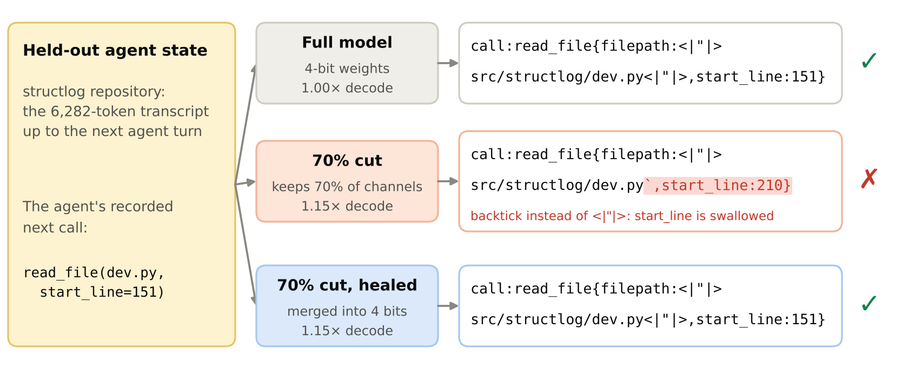
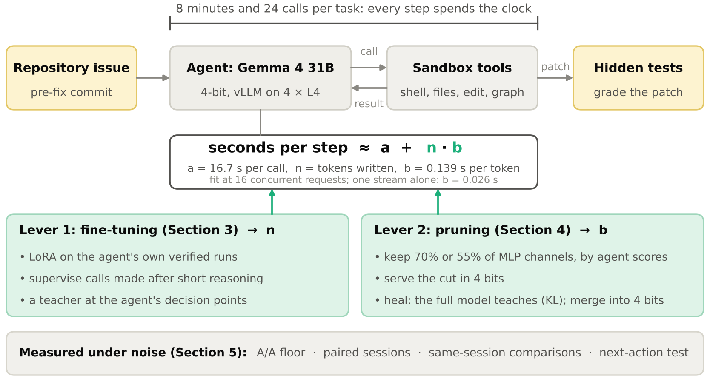
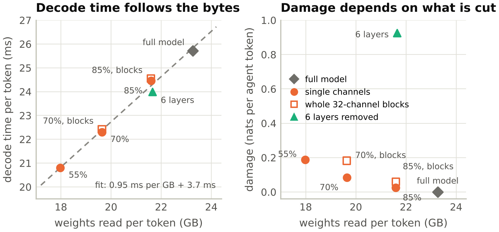
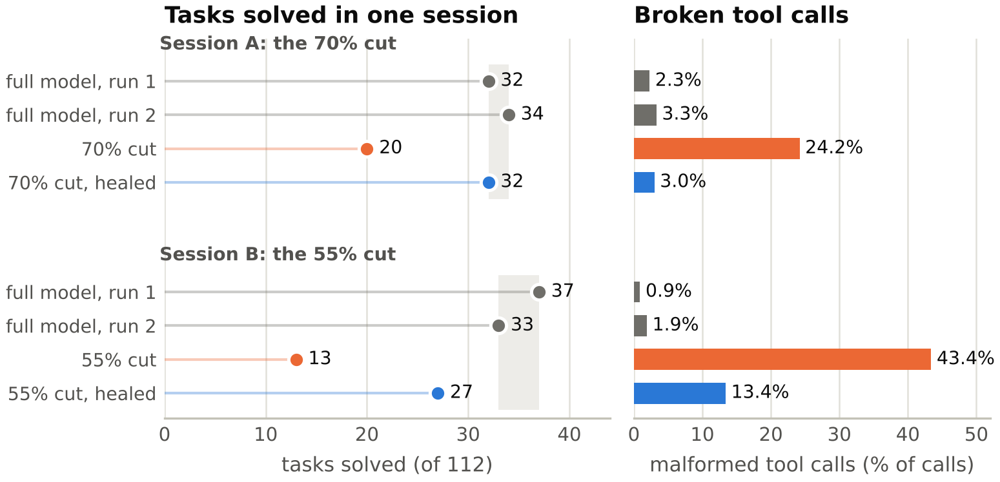
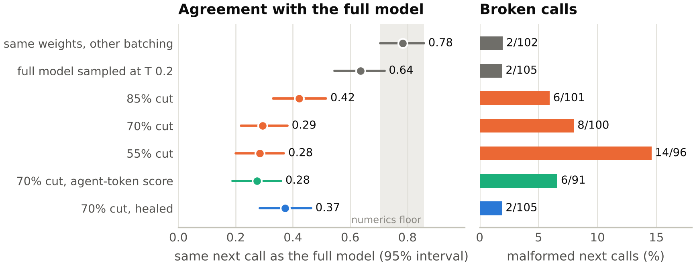
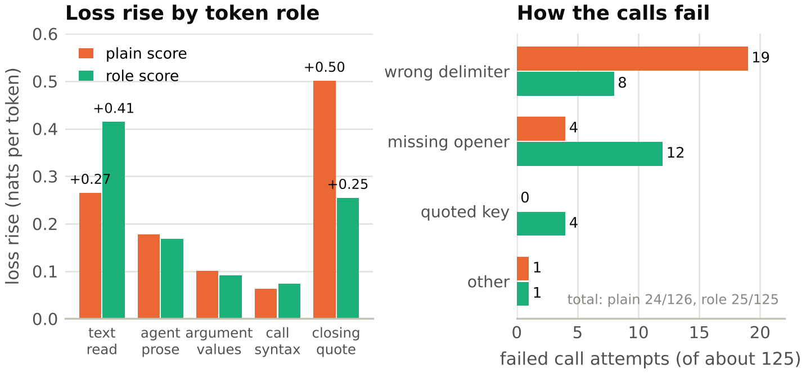
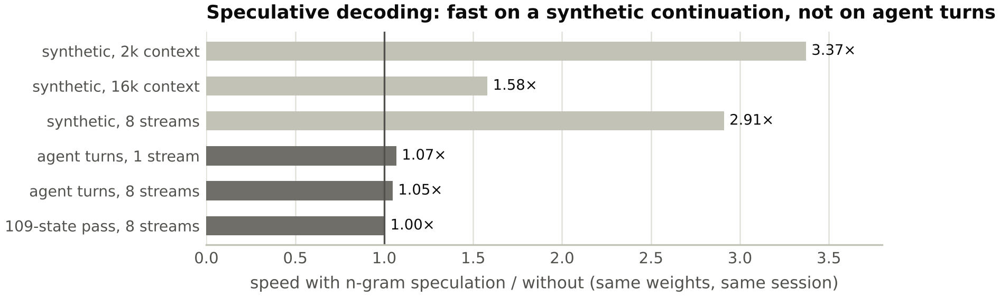

# Under the Clock: Shorter Steps and Fewer Bytes for Tool-Using Agents

**Subtitle:** Making Gemma 4 faster per step bought no tasks beyond noise; breaking its tool calls lost many

## Abstract

In the Gemma 4 Developer Agent competition, Gemma 4 31B, in 4 bits on four L4 GPUs, gets 8 minutes and 24 tool calls per
repository issue. We made steps faster two ways and traced each to tasks solved. Fine-tuning on the model's own verified
trajectories moved its reasoning length before each tool call: supervising only calls after short reasoning solved more
development tasks (25 vs 18, exploratory), not more unseen ones, and a teacher's preferences halved the slow steps but
broke the agent's stopping. Keeping 70% of the MLP channels, chosen on agent trajectories, decodes 1.15 times faster for
+0.08 nats per agent token, yet the cut solved 20 of 112 tasks against 32 and 34 for two full-model runs (p 1.5e-5): its
string arguments ran into one another in 24% of its calls (full model: 2-3%). Healed with the full model as teacher and
merged into the 4-bit weights by stochastic rounding, it kept its speed and solved 32 (-1 task, 95% interval -7.5 to
+5); keeping 55%, healing won back 14 of 22 lost tasks. Average per-token loss ranked the cuts but did not locate the
failure; a 15-minute next-action test did. Under a clock, how an agent writes its calls and when it stops decided more
than how fast it decodes. Code and notebooks:
[github.com/wilmerhenao/under-the-clock](https://github.com/wilmerhenao/under-the-clock).

*Figure 1. One held-out agent state, three models. The 70% cut ends the path with a backtick instead of Gemma's string
delimiter `<|"|>`, swallowing `start_line`; healed and merged, it writes the full model's call.*

## 1. Introduction

An agent that writes fewer tokens per step, or writes each faster, gets more steps under a clock. We pulled two levers
on seconds per step, fine-tuning and pruning. How the agent reasons, writes tool calls and stops outweighed every gain
in model speed we measured. Our contributions:

1. Fine-tuning moves reasoning length before decisions; a teacher at the agent's decision points shortened steps and
   broke stopping.
2. An agent-chosen cut has the 4-bit loss and speed its bf16 mask and bytes predict, yet fails through malformed tool
   calls (Figure 1) that average loss ranks but does not locate.
3. Healed from the full model and merged by stochastic rounding, the cut keeps its speed and stays within noise of the
   full model's task rate.
4. We measure agents under noise with an A/A floor, same-session comparisons and a next-action test.

## 2. Setting

**Harness.** The competition's harness compiles a declarative agent (YAML, prompts, optional LoRA adapters) and runs it
in a sandbox at the repository's pre-fix commit, with shell, file, edit, patch and three code-graph tools. Hidden tests
grade the agent's diff, submitted or not, as in SWE-bench (arXiv:2310.06770), but a timeout loses the task: none of our
2,027 timed-out episodes passed, even after a submitted patch. Each *episode* (one attempt at a task) gets 8 minutes, 24
tool calls, a 4,096-token thinking budget and temperature 0.2; the agent sees these budgets and can ask for the time
left. An episode *loops* when it repeats one call, arguments included, three times in a row. At 14,336 tokens the model
summarizes older events (compaction). Evaluation repositories are outside our training pools. The scorer serves one
4-bit (W4A16) checkpoint with LoRA adapters under 3 GiB, so we study pruning for self-hosted agents on the competition's
model, harness, hardware and clock.

**Hardware and clocks.** Training ran on a TPU v5e-8, serving on 4x L4 with vLLM (tensor parallel 4) and the
competition's checkpoint of Gemma 4 31B (arXiv:2607.02770, one scale per 32 inputs). *Paired sessions* (Section 3) put
two arms on one server, 8 concurrent tasks each, on a 16-minute clock. There a call writing n tokens takes a + n·b
seconds (Figure 2), and calls take 98% of episode time: fine-tuning acts on n, pruning on b and on the prefill inside a.
The *same-session comparison* (Section 4) runs checkpoints that cannot share a server one at a time on the same tasks, 8
at once on the 8-minute clock, in ABCD-DCBA order over two blocks, so neither order nor time favours a model.

*Figure 2. The agent under the clock and the two levers.*

## 3. Lever 1: fine-tuning moves length first

**Pipeline.** We ran Gemma through the harness in private Kaggle Benchmarks tasks on SWE-rebench-style
(arXiv:2505.20411) task banks and FreshSWE-Py (kaggle.com/datasets/moshegolderson/freshswe-py, issues filed after
the model's cutoff), excluding the development repositories, and kept the runs whose diffs passed the hidden
tests, re-rendered as the scorer sees them. A rank-16 LoRA on all projections is trained on TPU (JAX/Tunix, fp32
factors) with the loss on tool-call bodies only; each adapter is named after what it supervises.

| adapter | supervision | p90 step text vs base | solved vs base (discordant: only-this / only-base) |
|---|---|---|---|
| *Imitation* | stronger models' public trajectories (SWE-smith, SWE-Gym, R2E-Gym, SWE-Zero), whole turns | 0.24x | 16 vs 26 of 103 (4/14), p 0.031 |
| *Thought-first* | own runs, only turns opening with a thought | 1.72x | 19 vs 27 (0/8), p 0.008 |
| *Every-call* | own runs (422), compaction-aware, every call | 1.11x | 16 vs 22 (2/8) |
| ***Short-thought*** | *Every-call*'s recipe, 458 runs, calls after thoughts <= 1,500 chars | **0.90x** | **25 vs 18 (8/1), p 0.039**; unseen: 17 vs 19 of 64 (2/4) |
| *Short-thought+* | the same, +153 runs | 1.03x of *Short-thought* | vs *Short-thought*: 18 vs 18 dev; 27 vs 35 of 125 unseen (1/9), p 0.021 |

**Length moved in both directions.** *Imitation* wrote short narrated thoughts and looped (26 consecutive re-reads of
one file) while its validation loss fell from 1.05 to 0.37. *Thought-first* trained only on turns that opened with a
thought, which selected long ones: served, it thought long on every turn and made 1,171 model calls to the base's 1,709
in the same time.

**One filter reversed *Every-call*'s longer steps.** With *Every-call*'s recipe on 36 more runs, *Short-thought*
supervised a call only if at most 1,500 characters of reasoning preceded it (59% of calls): shorter steps, timeouts 38
to 24, and 25 vs 18 solved. No reasoning token was trained, so length moved only through which calls were supervised;
the adapter seems to generalize the deliberation before them, as short-chain training did elsewhere (arXiv:2505.17813).
The gain is exploratory: on unseen repositories *Short-thought* tied the base, and more data (*Short-thought+*) lost
there (77 timeouts vs 53), as on the public leaderboard (0.10 vs 0.18, base 0.15).

**A teacher at decision points.** At 717 agent states, mostly from slow or failed episodes, the stronger
Gemini 3.8 Flash (gemini-3.8-flash, medium thinking) judged Gemma's next step or wrote its own (589 preference pairs,
$9.21). Trained from the base (*Teacher-DPO*), Gemma took the teacher's style (90th-percentile step 172 tokens;
*Short-thought*, 514 in that session) but looped (36 of 98 episodes) and lost to *Short-thought* (20 vs 27). A second
stage on *Short-thought* computed the preference in each training step (*Teacher-DPO-2*, DPO plus a next-token loss on
the teacher's step, RPO in arXiv:2405.16436). It removed the losses to *Short-thought* (20 vs 17, 5/2), looped in 6 of
70 episodes besides re-submitting, and kept steps short (229 vs 610 tokens, 56 vs 125 s at the 90th percentile), yet the
agent was not faster. Once a patch is submitted, an episode ends at the first response without a tool call, but in 38 of
its 65 submitting episodes *Teacher-DPO-2* kept calling tools until the clock took the task, though its patch changed in
only 1 of 65. The next-token loss alone kept stops normal but looped (31 of 103, near *Teacher-DPO*'s rate). The
teacher's data shortens steps and brings loops; the in-step preference term prevents them but breaks the stop.

## 4. Lever 2: prune what the agent does not use

Each of the model's 60 layers has a gated MLP with 21,504 hidden channels (about 70% of the layer's weights). We score
each channel by the RMS of its activation over 300 agent trajectories (2.37 M tokens) times the norm of its
down-projection weights; a cut is an exact mask, without retraining. Its *damage* is the rise in nats per token on
*agent tokens* (the thought and call of each turn with at most 1,500 characters of reasoning, 17% of the agent's text)
in 40 held-out trajectories from other tasks; the full model scores 0.26. The 70% cut (70% of channels kept, 21% of layer weights)
costs +0.080 with agent scores, +0.867 with WikiText-103 scores (in chat format) and +0.533 at random (one seed): each
score keeps its own domain's channels.

**Real 4-bit cuts.** We cut the competition's 4-bit checkpoint and served each cut in vLLM, keeping a multiple of 512
channels per layer for the 4-bit kernels (69% for the 70% cut). Single channels are re-quantized (activation-weighted);
whole 32-channel groups, exact in 4 bits, lose twice as much. The 85%, 70% and 55% cuts decode 1.05, 1.15 and 1.24 times
faster (1.03-1.14 at 8 streams) for a served damage of +0.025, +0.084 and +0.188, within 0.005 nats of what their bf16
masks predicted; removing 6 layers by block influence (arXiv:2403.03853) costs +0.925 at 1.07x (Figure 3).

*Figure 3. Decode time follows the bytes read (left). At equal bytes, damage depends on what is removed (right).*

**Tasks under the clock.** In the same-session comparison (112 unseen-repository tasks, Figure 4) the 70% cut solved 20
tasks against 32 and 34 for two full-model runs, which differed on 8 tasks (3/5). It won none of the 12 and 14
tasks that separated it from them (two-sided sign-flip test on per-task differences from the runs' mean: 17 tasks, all
against it, p 1.5e-5), losing them at the clock (72 timeouts against 43-44). The failure is in the call syntax (Figure
1): a string closed with a backtick or a JSON quote instead of Gemma's delimiter swallows the next argument, in 24% of
the cut's calls against 2-3% for the full model. The call fails, the agent resends it, and 42 episodes looped
(full-model runs: 4 and 7).

*Figure 4. Same-session comparisons on 112 unseen-repository tasks. Grey band: two runs of the full model.*

**Healing from the full model.** A rank-16 LoRA is trained for two epochs on 628 agent trajectories in two arms on
identical batches: the KL arm minimizes KL(full || cut) at every token, the next-token arm the next-token loss. The KL
arm met its pre-registered bar (damage below +0.04, KL halved; 2.4 TPU hours): in the trainer's bf16 evaluation damage
fell from +0.085 to +0.021 and KL on agent tokens from 0.098 to 0.042. The next-token arm reached -0.078, below the full
model, while its KL rose to 0.243; it fit the data rather than the model, though its next calls matched the full model's
as often (16 of 38 states each). Through vLLM's LoRA path the adapter costs the whole speedup (1.02x against 1.15x).
Rounding W + dW to the nearest 4-bit value would erase the repair, whose deltas average 5% of a grid step (as
Scale-QLoRA, arXiv:2609.04526, found), so we round stochastically (up or down at random, exact in expectation): from one
draw, the merged cut keeps the repair (+0.022 nats) and the speed (1.15x).

In the same-session comparison the merged cut solved 32 of 112, within noise of the full model (-1 task, 95% interval
-7.5 to +5, discordant 5/5 and 6/8; against the unhealed cut 15/3, p 0.0075), though with no margin fixed in advance
this is not non-inferiority. It made 3% malformed calls. Faster per call (16.9 s against 19.0-19.3 s at equal length),
it had 36 timeouts against 43-44, but most of the difference became endings at the 24-call cap (21 against 12-16), which
pass one time in five: under the cap its speed was worth about one task. On the 55% cut (1.24x), healing recovers the
same share of the damage (+0.185 to +0.047) and 14 of the 22 lost tasks, still short of the full model (p 0.007), and
malformed calls fall from 43% to 13% (full model 1-2%).

**A next-action test.** At 109 held-out agent states (40 held-out trajectories), each model's greedy next call is
compared with the full model's (Figure 5). The same weights with other batching agree on 78% of calls, a numerics floor
(arXiv:2506.09501), sampling at the agent's temperature on 64%, and the cuts, healed or not, on 28-42%. Exact agreement
does not track tasks (the cuts solving 20 and 13 agree on 29% and 28%), but the malformed share and agreement with the
call the agent recorded do (full 0.40, healed 0.34, 70% 0.28, 55% 0.24). The test is a gate, not a predictor, and a thin
one (8 malformed calls of 100 against 2 of 102, p 0.06; sessions compound them to 24%).

*Figure 5. The next-action test at 109 held-out states (agreement over the 102 where the full model calls; malformed
shares over each model's calls). Grey band: the same weights with other batching.*

**Two scores for pruning reasoning.** Scoring channels only on agent tokens, in the spirit of RAC's calibration on the
model's own chains (arXiv:2509.12464), changed nothing at 70% (Figure 5). Scoring by token role (after SKIM, Section 6)
gives an equal vote to text read, prose, argument values, call syntax and the closing quote (0.08% of positions), where
the 55% cut's loss rose most (+0.50 nats, against +0.19 overall). At 141 states the role-scored cut halved both that
rise and the wrongly closed strings, but its calls lost their opener (their first token) instead (Figure 6): 20% of its
attempts failed against 19% (pre-registered one-sided Fisher test on parsed calls: 12/112 vs 20/122, p 0.14; paired over 103
states, McNemar p 0.02). Offline, a parser that accepts a backtick or a JSON quote as a string's closer repairs 53 of the
cuts' 68 malformed next calls; neither it nor grammar-constrained decoding (arXiv:2411.15100) was tested on tasks.

*Figure 6. Scoring by token role (55% cut, 141 states). The closing quote recovers and the opener breaks.*

**Speed without a cut.** N-gram speculative decoding kept the full model's calls (89% the same next call) but sped up
real agent turns only 1.05-1.07x (3.4x on synthetic text, Figure 7); we did not test Gemma 4's own drafter
(arXiv:2607.02770).

*Figure 7. N-gram speculative decoding against plain decoding (full model, same session).*

## 5. Measuring agents under noise

**Pairing and the noise floor.** Between sessions the same model moved by up to ten tasks and flipped 7-14% of the same
unseen tasks, so paired sessions, compared by discordant tasks (exact McNemar), separated adapters. Two identical
full-model arms on one server, the A/A floor, flipped 6 of 82 tasks (2/4), as many as across sessions: pairing controls
load and time of day but not the flips, so only lopsided splits such as 8/1 carry signal. Pairing also shares the
server, so an arm that writes less speeds up its control. Single-session p-values near 0.04, among about twenty adapter
comparisons, are exploratory; the same-session, role and speculation tests were pre-registered in dated entries we
release.

## 6. Related work

Fine-tuning on a model's own filtered successes dates to expert iteration (arXiv:1705.08439), STaR (arXiv:2203.14465)
and ReST-EM (arXiv:2312.06585); SWE-Gym (arXiv:2412.21139) found it weak for software agents. Cuadron et al.
(arXiv:2502.08235) measured overthinking in agents, and On the Clock (arXiv:2610.10833) agents under wall-clock budgets,
which fill spare time with repeated actions, as *Teacher-DPO-2* did. *Teacher-DPO*'s collapse under DPO
(arXiv:2305.18290) resembles likelihood displacement (arXiv:2410.08847, arXiv:2402.13228).

Perplexity misses what compression breaks (arXiv:2310.01382), for agents too (ACBench, arXiv:2505.19433, worst on JSON
outputs); flips and KL track it better (arXiv:2407.09141). 4-bit quantization hides amplified agent failures behind flat
scores (arXiv:2607.27275); for pruning we trace them to call syntax. Our channel score is FLAP's Wanda-sp
(arXiv:2312.11983), a structured Wanda (arXiv:2306.11695), and calibration data steer it (arXiv:2311.09755,
arXiv:2410.17711). Reasoning models are pruned with calibration on their own chains (RAC; SSGR, arXiv:2511.18864; RESP,
arXiv:2512.02185; OBC-Prune, arXiv:2609.17890), without tools or a clock. Concurrent SKIM (arXiv:2611.07558) prunes
tool-calling agents by per-role saliency and heals on-policy, under a grammar that enforces the format.

Minitron (arXiv:2407.14679) is our cut-then-distil template, and healing after pruning goes back to arXiv:2403.17887;
LLM-Pruner (arXiv:2305.11627) retrains, and self-data distillation (arXiv:2410.09982) heals with the unpruned model's
outputs. We heal with off-policy forward KL (on-policy: arXiv:2306.13649, arXiv:2306.08543) and merge by stochastic
rounding (rounding choices: arXiv:2004.10568), while QA-LoRA (arXiv:2309.14717) and LoTA-QAF (arXiv:2505.18724) train
merge-ready adapters and PEQA (arXiv:2305.14152) tunes the scales. Speculative decoding (arXiv:2211.17192,
arXiv:2302.01318) keeps the model's outputs, and SuffixDecoding (arXiv:2411.04975) targets agents. Agent reruns vary by
2-6 points (arXiv:2602.07150; error bars: arXiv:2411.00640).

## 7. Limitations and conclusion

With one model, harness and competition, the mechanisms (supervised actions condition reasoning length, cuts break rare
syntax tokens, preference terms move stopping) may generalize but the numbers need not. The fine-tuning gain held on
development repositories only, and we did not try policy-gradient training (arXiv:2502.18449). Each cut has one mask,
without reconstruction, one healing run and one rounding draw. The token-level tests cover short-reasoning turns within
8,192 tokens, on held-out tasks that share repositories with training rows. We did not rescale the clock: two in five of
the full model's solved episodes end after 7 minutes, so speed should pay more where the call cap does not bind. The
healed cut's result is one session of 112 tasks at our own load (8 tasks at a time).

Before asking what a faster model buys an agent, measure the agent: its tokens per step, which fine-tuning moves first,
and its time per token, which follows the bytes read. Before any long run, check cheaply whether it still writes its
calls and stops as it did; on a clock, those decided every result we measured.

**Disclosure.** The author works in Advanced Engineering at Invesco. This work, outside that role, used no Invesco
resources.
